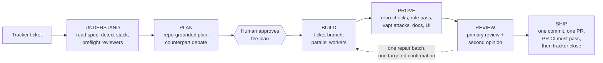
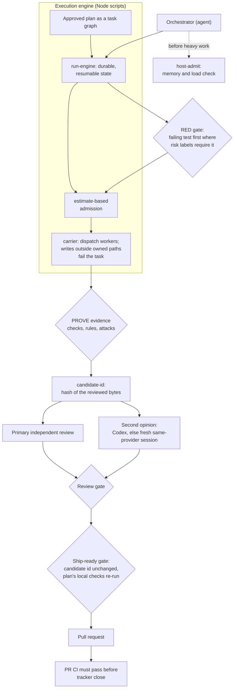

# Agentic Software Factory

[](https://github.com/AhmedAbdelfattah0/agentic-software-factory/actions/workflows/validate.yml)
[](LICENSE)
[](package.json)

Agentic Software Factory is an open-source, hybrid software engineering framework that combines agentic intelligence, human governance, deterministic execution controls, and independent review to deliver verified software changes.

**Hybrid by design:** AI handles reasoning, planning, and implementation, while deterministic mechanisms enforce critical engineering guarantees. Each layer does what it does best, balancing adaptability, reliability, and maintainability without unnecessary complexity.

**Intelligent planning. Human authorization. Deterministic execution controls. Independent assurance.**

The framework is packaged as agent skills that follow the open [`SKILL.md` standard](https://agentskills.io).
That standard is the delivery mechanism, not the identity: it lets the same framework run in
[Claude Code](https://claude.com/claude-code) and install into OpenAI Codex, Gemini CLI and Google
Antigravity too. The flagship workflow, `ship-ticket`, takes a tracker ticket (Jira or Azure DevOps)
through UNDERSTAND, PLAN, BUILD, PROVE, REVIEW and SHIP, and ends with one reviewed pull request.

> **Repository name.** This repository was renamed from `AI-Skills` to `agentic-software-factory`.
> The old URL redirects. Several identifiers keep the old name for compatibility, see
> [docs/legacy-identifiers.md](docs/legacy-identifiers.md).

## Why hybrid?

Hybrid is a deliberate architectural choice, by design, not by limitation.

- **Pure agentic systems** are flexible, but instructions alone give no deterministic guarantees.
- **Pure deterministic systems** are predictable, but turning every engineering decision into fixed
  rules adds complexity and removes flexibility.
- **Hybrid systems** combine adaptive reasoning with verifiable engineering guarantees.

Four complementary layers work as one system:

| Layer | What it does |
|---|---|
| **Agentic intelligence** | Understands the ticket and the codebase, writes a repository-grounded plan, labels each task's risk, complexity and owned paths, builds on a ticket branch and runs the proof steps. Judgement lives here. |
| **Human governance** | A person approves the plan once before any implementation, and holds every owner-class decision: scope changes, waivers, security exceptions, destructive actions and merge. |
| **Deterministic controls** | Node scripts that compute and refuse at the process boundary: plan and task-graph digests, required evidence per risk label, the failing-test-first gate, parallel scheduling, ownership detection, durable state, candidate hashing and the ship-ready gate. |
| **Independent review** | A primary review plus a separately recorded second opinion on a hashed candidate. The gate checks that both records are complete, fresh and from distinct reviewers. |

The split is deliberate: judgement stays with the agent and the person, and the controls that must
give the same answer every time are code.

## What it can do

| Capability | What it means here |
|---|---|
| Adaptive planning and risk/complexity classification | The planner labels each task's risk and complexity; the person approves the labels with the plan; the engine enforces the consequences. |
| Risk-based model routing | Tasks carry a tier label (`economy`, `balanced`, `strong`, `inherit`) that the host maps to real models. For engine-dispatched writers, risky and complex work is always `strong`, and an unmapped `strong` tier is refused rather than downgraded. Review is run by the orchestrator, which uses a strong model by policy. |
| Dependency-aware parallel execution | Independent tasks run in parallel; conflicting writes, reads and named resources (a port, a database) are serialized. |
| Resource-aware execution | The engine holds extra parallel work when the plan's memory estimates exceed an estimated budget. Before heavy work the orchestrator runs a macOS host check that holds under memory pressure, swap growth or high load. |
| File ownership detection | The plan names the files each worker may change. After a worker exits, the engine detects any write outside that list and fails the task. |
| Durable state and crash recovery | Engine state is atomic and resumable after a crash or a killed session (POSIX). |
| Incremental execution and evidence reuse | Work is fingerprinted by content; when an input changes, only the affected tasks and their dependents are re-run. |
| Optional token budgets and usage tracking | A configured token ceiling stops new dispatch when spent. Usage is recorded from provider reports; no saving is claimed. |
| Risk-driven verification and security testing | Risk labels decide which evidence the ship-ready gate demands. Where the plan requires it, the engine runs the failing test itself before production code is accepted. `vapt` attacks a local instance and commits the abuse cases as tests. |
| Candidate integrity and digest binding | The approved plan, the task graph and the reviewed bytes are each pinned by a digest. A later change is refused or detected. |
| Independent reviews and second opinions | A second reviewer is recorded and must differ from the builders and the primary reviewer. Review allows one repair batch and one targeted confirmation. |
| Supervised sprint and extended execution | A supervised procedure for running several tickets in waves. It is not a scheduler and there is no unattended driver. |

Precise boundaries for each row: [docs/adaptive-execution.md](docs/adaptive-execution.md) and
[docs/engine-guarantees-and-limits.md](docs/engine-guarantees-and-limits.md).

### How it adapts

1. **The planner labels.** The plan records each task's risk labels, complexity and owned paths.
   Plans are challenged by a second model by default; disagreement is shown to the person, never
   turned into consensus.
2. **The person approves.** The approval covers the plan and its digest.
3. **The engine enforces.** Strong tier for risky and complex writer tasks; required evidence per
   risk label; failing test first where the labels require it; conflict-aware parallelism; one repair
   and one confirmation.

Which parts are planner-driven, which are orchestrator procedures and which are programmatically
enforced is laid out in [docs/adaptive-execution.md](docs/adaptive-execution.md).

## What is in this repository

| Skill | What it does |
|---|---|
| [`ship-ticket`](skills/ship-ticket/SKILL.md) | Implements one Jira or Azure DevOps ticket end to end: UNDERSTAND, PLAN, BUILD, PROVE, REVIEW, SHIP. Includes the execution engine, gates and the sprint/extended-run procedure. |
| [`vapt`](skills/vapt/SKILL.md) | Adversarial testing of code that was just written. Attacks a local instance and commits the abuse cases as tests, so the repository's CI re-runs them. |
| [`code-quality`](skills/code-quality/SKILL.md) | Rules for any language plus Angular (`NG-*`) and backend (`BE-*`) rule sets that the agent and reviewer apply, a Design Contract gate and a verification pass. |
| `angular-code-quality`, `backend-code-quality` | Deprecated alias stubs for one release. They hold no rules and point at `code-quality`. |
| [`test-quality`](skills/test-quality/SKILL.md) | Quality gate for generated or changed test code (mock abuse, tests that catch nothing). |
| [`docs-accuracy`](skills/docs-accuracy/SKILL.md) | Checks that READMEs, API docs and changelogs tell the truth about the code. |
| [`nn-guard`](skills/nn-guard/SKILL.md) | A grep-level editor hook and CI job that block a small set of unambiguous `code-quality` non-negotiable patterns. |
| [`generate-ticket`](skills/generate-ticket/SKILL.md) | Writes implementation-ready ticket content (markdown, CSV, index). It never creates items in a tracker. |

General-purpose skills (design-prompts, marketing-video, project-audit, security, security-audit,
self-healing, session-logger, session-restore) no longer live here. They are in
[ai-agent-skills](https://github.com/AhmedAbdelfattah0/ai-agent-skills). If you installed the removed
skills from this repository, `node scripts/cli.mjs update --prune` removes the links that are now dead.

[AGENTS.md](AGENTS.md) is the canonical instruction file for anyone changing this repository.

## How a ticket becomes a pull request



Details: [docs/lifecycle.md](docs/lifecycle.md).

## Engine, gates and the review chain



The second opinion prefers Codex. When Codex is unavailable or out of quota, a fresh session of a
different model from the same provider is used instead; that is recorded as a **same-provider**
independent review and is never reported as cross-provider agreement.

Details: [docs/architecture.md](docs/architecture.md), [docs/gates-and-security.md](docs/gates-and-security.md),
[docs/model-routing-and-reviews.md](docs/model-routing-and-reviews.md).

## Security governance

- **Two security layers, one boundary.** `code-quality` reads code (static `BE-*` rules). `vapt`
  runs it: it attacks a local instance and commits the abuse cases as tests, so the repository's CI
  re-runs them. Whether a red CI blocks the merge depends on your branch protection.
- **Approval boundary.** A person approves the plan before any implementation. The approved plan names
  the files each worker may change; changing the plan needs a new approval because its digest no
  longer matches.
- **Digest binding.** The approved plan, the `vapt` control catalog and the reviewed candidate bytes
  are each pinned by a digest. A change after approval or after review is detected, not trusted.
- **Security pairs.** For security work run with the security policy bound, each selected boundary and
  control pair needs a committed test that failed first and now passes before ship-ready.
- **Rules of engagement.** Attacks target a local disposable instance, never production or shared
  staging; this is a rule the agent follows.
- **Auto-update trust.** Automatic updates pull the default branch unattended, so you trust upstream
  with code your agent will execute. Skip scheduling with `AI_SKILLS_NO_AUTOUPDATE=1`; see
  [SECURITY.md](SECURITY.md).

Details: [docs/gates-and-security.md](docs/gates-and-security.md).

## Quick start

```bash
# 1. Install (see Installation for the options)
npx github:AhmedAbdelfattah0/agentic-software-factory install generate-ticket ship-ticket

# 2. In Claude Code, inside the repository you want to change:
#    /ship-ticket PROJ-123
```

`ship-ticket` reads the ticket from the tracker, writes a plan for your approval, builds on a ticket
branch, proves the result with the repository's own checks, gets a primary review and a recorded
second opinion, and opens one pull request. Use `generate-ticket` first when you need to write the
backlog.

## Installation

Needs `git` and Node 22+. The supported ways to install are these three.

```bash
# A. One line, with automatic updates (macOS, Linux, WSL or Git Bash)
curl -fsSL https://raw.githubusercontent.com/AhmedAbdelfattah0/agentic-software-factory/main/install.sh | bash

# B. npx straight from GitHub (skills are copied; run "update" later to refresh)
npx github:AhmedAbdelfattah0/agentic-software-factory list
npx github:AhmedAbdelfattah0/agentic-software-factory install

# C. Clone, then install (symlinked; best if you will edit skills)
git clone https://github.com/AhmedAbdelfattah0/agentic-software-factory.git
cd agentic-software-factory
node scripts/cli.mjs install
```

> **Do not run bare `npx` package names.** `ai-skills` and `ai-agent-skills` on the npm registry are
> published by other people and are not this project. Always use one of the three forms above.

Other tools take `--target codex|gemini|antigravity|all`. The installer (`install`) never deletes something it
does not own; `update --adopt` and `update --force` are explicit opt-ins that replace contents without a
backup. Full options, collision handling, the install layout diagram and automatic updates:
[docs/installation.md](docs/installation.md).

## Verified vs not yet exercised

The evidence status of each area. File pointers: [docs/evidence.md](docs/evidence.md).

| Area | Evidence status | Where |
|---|---|---|
| CLI and harness suites | Verified in CI on ubuntu, macOS and Windows (Node 22); engine property and mutation suites run on ubuntu | [`validate.yml`](.github/workflows/validate.yml) |
| Installer protection against replacing things it does not own | Verified in CI | `scripts/cli.test.mjs` |
| Engine gates (RED, review, ship-ready), digest binding, ownership detection, crash resume | Covered by the engine test suites; not yet exercised end to end on a real ticket | [docs/evidence.md](docs/evidence.md) |
| A full ticket run on a real repository | Partially evidenced: one partial run record on a real product repository is kept in `.specs/reviews`; n=1; not a clean engine-gated run | [KNOWN-ISSUES.md](KNOWN-ISSUES.md) |
| Same-provider second-opinion route; `vapt` attacks on a real target | Procedure and tests; not yet exercised in a recorded run | [docs/evidence.md](docs/evidence.md) |
| Sprint intake and wave queue | Dry run and cold-resume test | [sprint.md](skills/ship-ticket/references/sprint.md) |
| Azure DevOps | Not yet exercised end to end | [sprint.md](skills/ship-ticket/references/sprint.md) |
| Cost or time savings | Not measured | [docs/evidence.md](docs/evidence.md) |

## Known limits

- The engine's controls apply to runs the orchestrator drives through `run-engine.mjs`; the engine is
  POSIX and host admission is macOS.
- Workers share one working tree, so ownership is detected after a worker exits rather than prevented.
- Sprint and extended runs are a supervised procedure; there is no unattended driver.
- Telemetry is best effort.

The fuller list is in [docs/engine-guarantees-and-limits.md](docs/engine-guarantees-and-limits.md).

## Legacy identifiers

The repository is `agentic-software-factory`, but the CLI name (`ai-skills`), the `~/.ai-skills`
clone path, the `ai-skills/ship-ticket/` state path, `.ai-skills-manifest.json` and the
`com.ai-skills.update` scheduler label keep their old names for compatibility.
See [docs/legacy-identifiers.md](docs/legacy-identifiers.md).

## Contributing

Add `skills/<name>/SKILL.md`, keep the folder name equal to the frontmatter `name:`, then run
`node scripts/cli.mjs validate`. CI runs the same validator. The rules it enforces and why are in
[AGENTS.md](AGENTS.md).

## Security and license

Report vulnerabilities as described in [SECURITY.md](SECURITY.md). License: MIT, see [LICENSE](LICENSE).

Parts of `test-quality`, `docs-accuracy` and `code-quality` are adapted from [amElnagdy/guard-skills](https://github.com/amElnagdy/guard-skills) (MIT); the required copyright and license notice is in [THIRD_PARTY_NOTICES.md](THIRD_PARTY_NOTICES.md); vendored third-party code is listed in [skills/ship-ticket/THIRD_PARTY_NOTICES.md](skills/ship-ticket/THIRD_PARTY_NOTICES.md).
