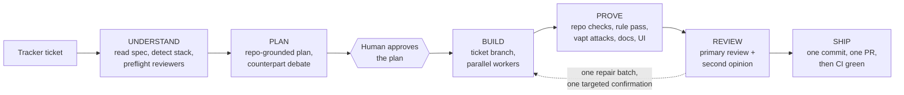
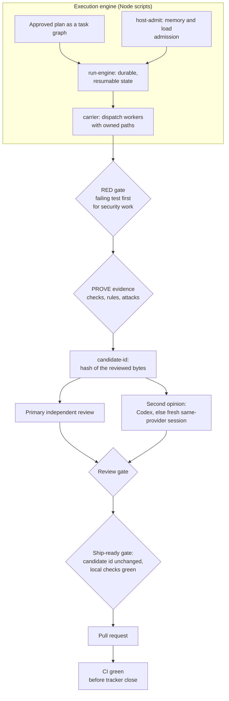
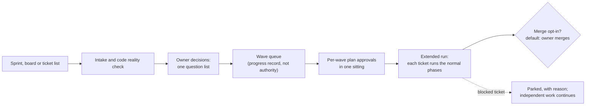
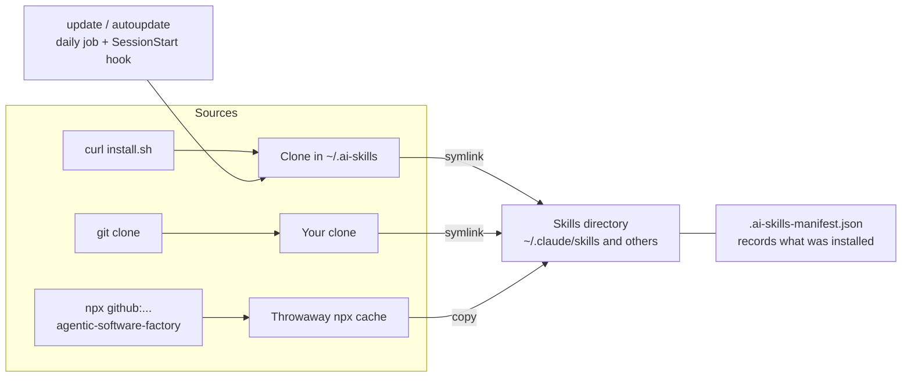

# Agentic Software Factory

A library of agent skills that turns a tracker ticket into a reviewed pull request, with a human
approving the plan, the repository's own checks proving the work, and an independent second opinion
reviewing it. The skills use the open [`SKILL.md` standard](https://agentskills.io); they are built
and exercised with [Claude Code](https://claude.com/claude-code) and install into OpenAI Codex,
Gemini CLI and Google Antigravity too.

The philosophy is small and strict. A model proposes, a person approves the plan once, deterministic
scripts and the repository's own CI decide what is proven, and a reviewer that did not write the code
checks it. Nothing merges on an agent's say-so, and every claim a gate makes can be traced to a file,
a digest or a test.

> **Repository name.** This repository was renamed from `AI-Skills` to `agentic-software-factory`.
> The old URL redirects. Several identifiers keep the old name for compatibility, see
> [docs/legacy-identifiers.md](docs/legacy-identifiers.md).

## What is in this repository

| Skill | What it does |
|---|---|
| [`ship-ticket`](skills/ship-ticket/SKILL.md) | Implements one Jira or Azure DevOps ticket end to end: UNDERSTAND, PLAN, BUILD, PROVE, REVIEW, SHIP. Includes the execution engine, gates and the sprint/extended-run procedure. |
| [`vapt`](skills/vapt/SKILL.md) | Adversarial testing of code that was just written. Attacks a local instance and commits the abuse cases as tests, so CI re-runs them. |
| [`code-quality`](skills/code-quality/SKILL.md) | Rules for any language plus enforced Angular (`NG-*`) and backend (`BE-*`) rule sets, a Design Contract gate and a verification pass. |
| `angular-code-quality`, `backend-code-quality` | Deprecated alias stubs for one release. They hold no rules and point at `code-quality`. |
| [`test-quality`](skills/test-quality/SKILL.md) | Quality gate for generated or changed test code (mock abuse, tests that catch nothing). |
| [`docs-accuracy`](skills/docs-accuracy/SKILL.md) | Checks that READMEs, API docs and changelogs tell the truth about the code. |
| [`nn-guard`](skills/nn-guard/SKILL.md) | Deterministic enforcement of the `code-quality` non-negotiable rules: an editor hook plus a CI job. |
| [`generate-ticket`](skills/generate-ticket/SKILL.md) | Writes implementation-ready ticket content (markdown, CSV, index). It never creates items in a tracker. |

General-purpose skills (design-prompts, marketing-video, project-audit, security, security-audit,
self-healing, session-logger, session-restore) no longer live here. They are in
[ai-agent-skills](https://github.com/AhmedAbdelfattah0/ai-agent-skills). If you installed the removed
skills from this repository, `node scripts/cli.mjs update --prune` removes the links that are now dead.

[AGENTS.md](AGENTS.md) is the canonical instruction file for anyone changing this repository.

## How a ticket becomes a pull request



Details: [docs/lifecycle.md](docs/lifecycle.md).

## Engine, gates and the review chain



Details: [docs/architecture.md](docs/architecture.md), [docs/gates-and-security.md](docs/gates-and-security.md),
[docs/model-routing-and-reviews.md](docs/model-routing-and-reviews.md).

## Sprint, wave queue and extended run



Details: [docs/sprint-and-extended-run.md](docs/sprint-and-extended-run.md).

## Install and update layout



Details: [docs/installation.md](docs/installation.md).

## Security governance

- **Two security layers, one boundary.** `code-quality` reads code (static `BE-*` rules). `vapt`
  runs it: it attacks a local instance and commits the abuse cases as tests, so CI blocks the merge
  rather than an agent's report.
- **Approval boundary.** A human approves the plan before any implementation. The approved plan names
  every file that may change; needing another path returns to approval.
- **Digest binding.** The approved plan, the `vapt` control catalog and the reviewed candidate bytes
  are each pinned by a digest. A change after approval or after review is detected, not trusted.
- **Host admission.** Heavy work (full suites, builds) asks `host-admit.mjs` first and holds under
  memory pressure.
- **Rules of engagement.** Runtime attacks target a local disposable instance, never production or
  shared staging.

Details: [docs/gates-and-security.md](docs/gates-and-security.md).

## Quick start

```bash
# 1. Install (see Installation for the options)
npx github:AhmedAbdelfattah0/agentic-software-factory install generate-ticket ship-ticket

# 2. In Claude Code, inside the repository you want to change:
#    /ship-ticket PROJ-123
```

`ship-ticket` reads the ticket from the tracker, writes a plan for your approval, builds on a ticket
branch, proves the result with the repository's own checks, gets two independent reviews, and opens
one pull request. Use `generate-ticket` first when you need to write the backlog.

## Installation

Needs `git` and Node 22+. The supported ways to install are these three.

```bash
# A. One line, with automatic updates (macOS, Linux, WSL or Git Bash)
curl -fsSL https://raw.githubusercontent.com/AhmedAbdelfattah0/agentic-software-factory/main/install.sh | bash

# B. npx straight from GitHub (skills are copied; run "update" later to refresh)
npx github:AhmedAbdelfattah0/agentic-software-factory list
npx github:AhmedAbdelfattah0/agentic-software-factory install

# C. Clone, then install (symlinked; best if you will edit skills)
git clone https://github.com/AhmedAbdelfattah0/agentic-software-factory.git
cd agentic-software-factory
node scripts/cli.mjs install
```

> **Do not run bare `npx` package names.** `ai-skills` and `ai-agent-skills` on the npm registry are
> published by other people and are not this project. Always use one of the three forms above.

Other tools take `--target codex|gemini|antigravity|all`. The installer (`install`) never deletes something it
does not own; `update --adopt` and `update --force` are explicit opt-ins that replace contents without a
backup. Full options, collision handling and automatic updates:
[docs/installation.md](docs/installation.md).

## Verified and not yet exercised

| Area | Status | Evidence |
|---|---|---|
| Engine and gate test suites run in CI on three operating systems | Verified | [`.github/workflows/validate.yml`](.github/workflows/validate.yml): CLI and harness suites on ubuntu, macOS and Windows, Node 22. |
| Installer protection against replacing things it does not own | Verified | Installer tests in `scripts/cli.test.mjs` (collision, backup and `--replace-foreign` cases). |
| A full ticket run on a real repository | Partially evidenced | Exercised on a real repository; the first real run ended in a terminal review FAIL that exposed a defect, now closed in [KNOWN-ISSUES.md](KNOWN-ISSUES.md) (issue 8). No public run record is committed. |
| Sprint intake and wave queue | Dry run only | Procedure in [sprint.md](skills/ship-ticket/references/sprint.md); exercised as a dry run and a cold-resume test, not as a live multi-wave run. |
| Azure DevOps | Not exercised | Only sprint intake is marked untested in [sprint.md](skills/ship-ticket/references/sprint.md); single-ticket Azure DevOps use is documented but has not been exercised end to end. |
| Unattended driver | Not exercised | No detached driver exists; extended run is an orchestration procedure, not a scheduler. |

The independent second opinion currently runs on a **same-provider substitute** (a fresh session of a
different model from the same provider) whenever Codex is unavailable. It is recorded as a
same-provider review, never as cross-provider agreement.

## Legacy identifiers

The repository is `agentic-software-factory`, but the CLI name (`ai-skills`), the `~/.ai-skills`
clone path, the `ai-skills/ship-ticket/` state path, `.ai-skills-manifest.json` and the
`com.ai-skills.update` scheduler label keep their old names for compatibility.
See [docs/legacy-identifiers.md](docs/legacy-identifiers.md).

## Contributing

Add `skills/<name>/SKILL.md`, keep the folder name equal to the frontmatter `name:`, then run
`node scripts/cli.mjs validate`. CI runs the same validator. The rules it enforces and why are in
[AGENTS.md](AGENTS.md).

Parts of `test-quality`, `docs-accuracy` and `code-quality` are adapted from
[amElnagdy/guard-skills](https://github.com/amElnagdy/guard-skills) (MIT), with primary-source citations in
their `references/` (`sources.md` in `test-quality` and `docs-accuracy`). License: MIT (see `package.json`).
