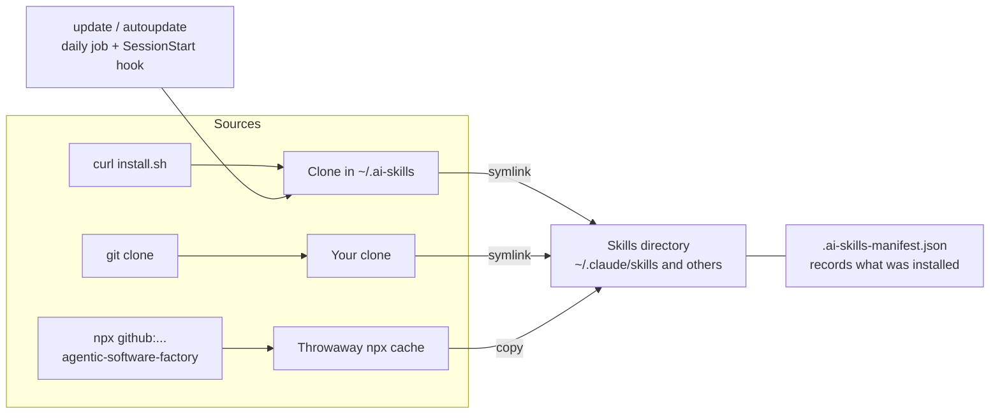

# Installation

Needs `git` and Node 22+. Repository: <https://github.com/AhmedAbdelfattah0/agentic-software-factory>.

> **Never run `npx` with the bare package names `ai-skills` or `ai-agent-skills`.** Those names on the npm registry belong
> to other publishers. Use only the forms below, which name this repository explicitly.

## Supported installs

### A. One line, with automatic updates

```bash
curl -fsSL https://raw.githubusercontent.com/AhmedAbdelfattah0/agentic-software-factory/main/install.sh | bash
```

Clones into `~/.ai-skills`, symlinks every skill into `~/.claude/skills`, and schedules automatic
updates. Overrides: `AI_SKILLS_TARGET=all` for every tool, `AI_SKILLS_HOME=<dir>` for the clone
location, `AI_SKILLS_REF=<branch|tag>`, `AI_SKILLS_NO_AUTOUPDATE=1` to skip scheduling,
`AI_SKILLS_REPLACE_FOREIGN=1` to back up and replace same-named entries that are not ours. The script
itself still names the old repository URL internally, which GitHub redirects.

### B. npx from GitHub

```bash
npx github:AhmedAbdelfattah0/agentic-software-factory list
npx github:AhmedAbdelfattah0/agentic-software-factory install
npx github:AhmedAbdelfattah0/agentic-software-factory install ship-ticket generate-ticket
npx github:AhmedAbdelfattah0/agentic-software-factory update
```

The source is a throwaway cache, so skills are copied. npm re-resolves the GitHub spec on every run,
so `update` always sees the current default branch.

### C. Clone, then install

```bash
git clone https://github.com/AhmedAbdelfattah0/agentic-software-factory.git
cd agentic-software-factory
node scripts/cli.mjs install            # symlinked; --copy for real files
```

From a clone the CLI symlinks (directory junctions on Windows), so `git pull` or editing a `SKILL.md`
is live with no re-install. A bash equivalent exists: `./scripts/install.sh`.

## Other tools

`--target codex|gemini|antigravity|agents|all` or `--dest <path>`. Codex and the interoperable agents
directory use `~/.agents/skills`, Gemini CLI `~/.gemini/skills`, Antigravity `~/.gemini/config/skills`.
A few skills contain steps that only make sense in Claude Code (`nn-guard` installs a Claude Code
hook; `ship-ticket` uses Claude Code commands and subagents); their knowledge still applies elsewhere.

## If something already has a skill's name

`install` replaces an entry only when it is ours: a link to this checkout's own skill, or a copy this
library recorded installing that nobody edited since. Anything else is left untouched, named, and the
installer exits with code 1. `--replace-foreign` moves each such entry to a timestamped backup under
`~/.local/state/ai-skills/` (or `$XDG_STATE_HOME/ai-skills/`, `%LOCALAPPDATA%\ai-skills\` on Windows)
and then installs. `--force` does the same backup-then-replace for the `code-quality` successor only.
Nothing that is not ours is deleted. When the one-line installer hits a collision it stops and says
that automatic updates were not scheduled.

`./scripts/install.sh` writes no manifest, so it recognises only its own links: a second `--copy` run
skips its earlier copies, each `--copy --replace-foreign` run moves the previous copies into a new
backup (backups accumulate until you remove them), and a copy made that way reads as unknown
provenance: `update` leaves it alone; once the library changes that skill, `update` says `--adopt` takes it over. Use the Node CLI if that matters. Source: `scripts/cli.mjs` and the installer
tests in `scripts/cli.test.mjs`.

## Updating

```bash
node scripts/cli.mjs update           # pull the source, re-sync what it installed
node scripts/cli.mjs update --check   # report only
node scripts/cli.mjs update --prune   # also remove skills deleted upstream
```

| Installed as | `update` does |
|---|---|
| Symlink into your clone | Nothing to copy; the pull was the update. |
| Symlink elsewhere | Reports it, never touches it. |
| Copy that matches the record | Refreshes it. |
| Copy you edited | Leaves it; `--force` overwrites it (your edits are lost; there is no backup). |
| Directory nobody recorded | Leaves it; `--adopt` takes it over (its contents are replaced; there is no backup). |

The source refresh is `git pull --ff-only` from a clean tree with an upstream; it never stashes,
rebases or discards. Copies are staged and swapped by rename, so an interrupted run leaves the working
skill in place.

## Automatic updates

`autoupdate --install` adds a daily job (launchd, systemd user timer or schtasks) and a Claude Code
`SessionStart` hook. Both run `update --auto`, which takes a lock, runs at most once an hour, ignores
`--force` and `--prune` (and `--adopt`), and writes only to its own log. `autoupdate --remove` takes both
back out.

## Verify

Run `/skills` in Claude Code, or restart it, and confirm the skills appear. `node scripts/cli.mjs
validate` lints a checkout.

## Install and update layout


