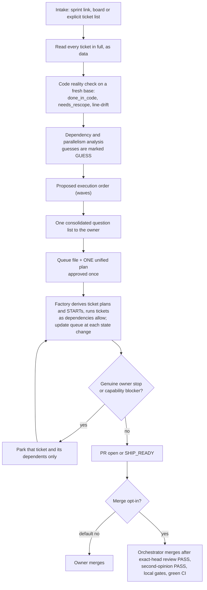

# Sprint and extended run

Source of truth: [skills/ship-ticket/references/sprint.md](../skills/ship-ticket/references/sprint.md).
This is an experimental, supervised procedure above the single-ticket workflow. It adds no engine, scheduler or detached
driver; every ticket still runs the normal phases, plan, review and gates.

## Flow

## Key rules

- **Intake.** Jira by sprint id or open sprints; Azure DevOps by iteration path (untested until first
  use); or an explicit ticket list or existing waves. Tickets with an open pull request and parked
  tickets are excluded, each with a reason.
- **Waves are an execution strategy, not an approval boundary.** One unified plan and one native approval cover the batch; the Factory writes each ticket's plan file and START afterwards without asking again. Three to four tickets per wave is a target. At most two ELEVATED tickets per wave, and only when
  they share no file, function, table or migration object, verified from the code. Tickets that share
  an object go in different waves in dependency order.
- **One question list.** Every product question, guess, merge-mode question, cap and the
  second-reviewer check go to the owner once, before any plan approval.
- **Queue file.** A markdown file under the repository Git common directory, never committed. It is a
  progress and resume record, never an execution authority: plan approvals, digests and engine state
  stay authoritative.
- **Cap.** Counted separately in tickets, wall-clock hours and second-reviewer runs. The orchestrator keeps the count.
- **Merge is always opt-in.** The default is that the owner merges, asked once, in the unified plan.
  Migrations, payments, row-level security and tickets with deploy preconditions always stay owner
  merge. Deploy is always a separate decision.
- **Owner stops and capability blockers** (security, approval, ownership, spent budget, a drift, security or base `RETRY`, no reviewer or credentials) park the ticket and its genuine
  dependents. Routine failures are corrected by the Factory inside the approved scope; routine rebasing is Factory work. Independent work continues.
- **Preflight.** Before the first ticket starts a second reviewer must be able to run and permissions must be
  pre-granted, or the run does not start.
- **Cold resume.** A fresh session reads the queue and artifacts, re-checks the live tracker, pull
  requests and base, and names the next permitted action. Artifacts win over the queue.

## Status

Intake and the wave queue have been exercised as a dry run and a cold-resume test, not as a live
multi-wave run. The Azure DevOps path and any unattended driver are not exercised. See the table in
the [README](../README.md#verified-vs-not-yet-exercised).
